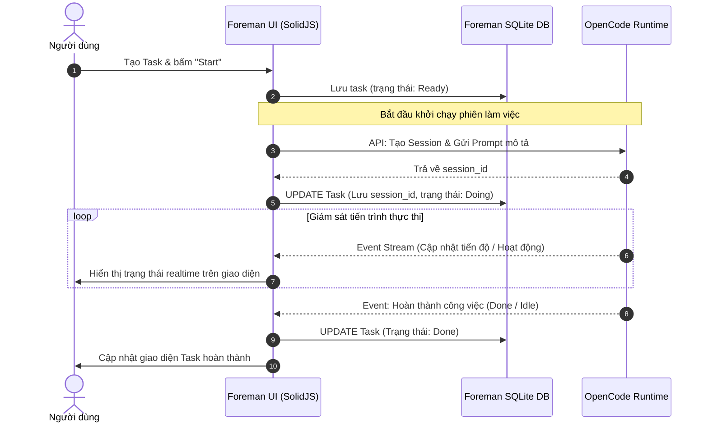

# Task Execution Sequence Flow

This document defines the core runtime sequence flow when a developer starts a task in Foreman and interacts with the OpenCode runtime and local SQLite database.

## Sequence Diagram

## Description of Steps

1. **Task Creation & Start Action**: The developer creates a task on the Kanban board, moves it to `Ready`, and explicitly triggers the **Start** action.
2. **Database Persistence**: Foreman UI records/updates the task state in the local SQLite database.
3. **Session Initialization**: Foreman initiates an API call (`session.create` & `session.prompt`) through the OpenCode client wrapper, sending the task description as the initial prompt.
4. **State Binding (1 Task = 1 Session)**: Upon receiving the generated `session_id` from OpenCode, Foreman binds it permanently to the task in the SQLite database and shifts the task state to `Doing`.
5. **Real-time Event Streaming**: Foreman listens to the OpenCode Event Stream, continuously updating the execution visibility on the SolidJS UI without requiring manual refreshes.
6. **Completion & Reconciliation**: When OpenCode signals completion or an idle state, Foreman updates the local database state to `Done` and reflects the final outcome on the user's board workspace.
